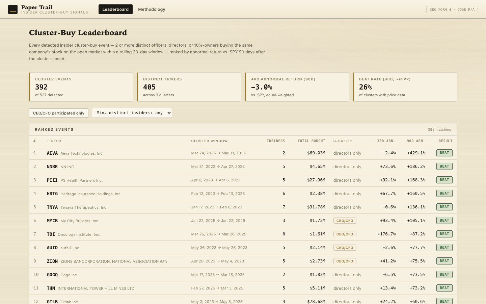
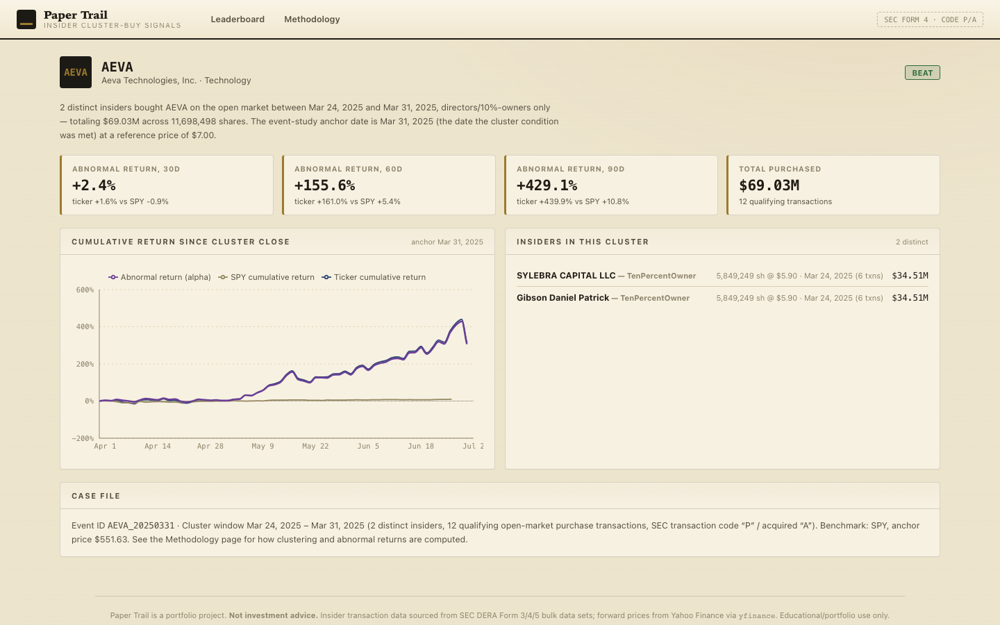
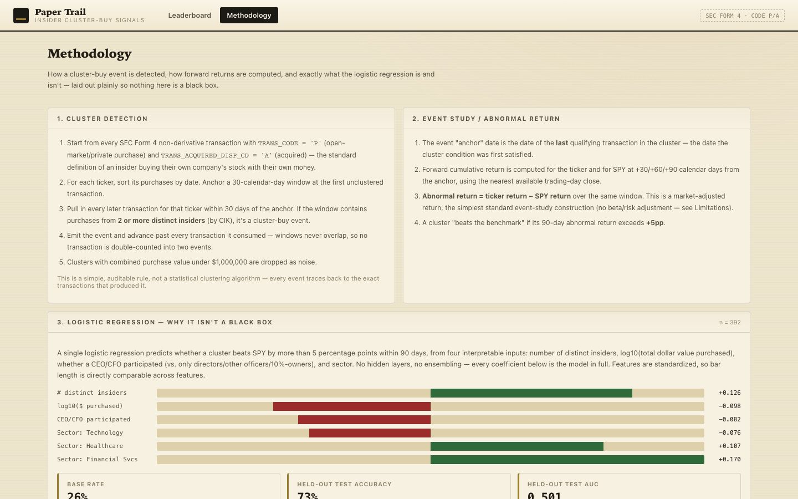

# Paper Trail

**Insiders leave a paper trail every time they buy their own stock — this tool follows it.**

> One of a series of portfolio projects targeting Financial Analyst / FP&A and
> quant-adjacent roles. Paper Trail is styled like a declassified case file —
> aged paper, redaction bars, stamped verdicts — because the product is
> literally about reading the public record insiders are legally required to
> leave behind, not about slick real-time dashboards.

---

## 1. Problem framing

When two or more distinct officers, directors, or 10%-owners of the same
company independently buy shares on the open market within a short window,
it's a stronger signal than any single insider's trade: one person might buy
for reasons that have nothing to do with the stock's outlook (diversification,
compensation timing, plain optimism), but several insiders converging on the
same open-market purchase, with their own money, in the same few weeks, is
harder to explain away. The academic literature on "insider cluster buys"
(Lakonishok & Lee 2001; Cohen, Malloy & Pomorski 2012) finds these clusters
carry modest but real predictive information about future returns.

Paper Trail builds this signal end-to-end from the actual public record: it
ingests SEC Form 4 filings, detects cluster-buy events with a simple auditable
rule, and — instead of just asserting the signal works — runs a real event
study measuring what actually happened to each stock in the 30/60/90 days
after the cluster, against SPY as a benchmark. The honest result (see §7) is
mixed, and the README says so.

## 2. Data sources & methodology

Both data sources are free and require no API key:

- **[SEC DERA Insider Transactions Data Sets](https://www.sec.gov/data-research/sec-markets-data/insider-transactions-data-sets)**
  — quarterly bulk TSV extracts of every Form 3/4/5 filed that quarter
  (`SUBMISSION`, `REPORTINGOWNER`, `NONDERIV_TRANS` tables). Filtered to
  `TRANS_CODE = 'P'` (open-market/private purchase) and
  `TRANS_ACQUIRED_DISP_CD = 'A'` (acquired) — SEC's own taxonomy for "insider
  bought shares with their own money," as opposed to option exercises,
  gifts, or plan-related transactions.
- **[`yfinance`](https://github.com/ranaroussi/yfinance)** — daily
  split/dividend-adjusted closes for every ticker with a qualifying cluster,
  plus SPY as the market benchmark.

### Quarters pulled

| Quarter | Why |
|---|---|
| **2023 Q1** | Silicon Valley Bank / Signature Bank collapse (Mar 2023) — acute, sector-concentrated volatility is exactly the environment where insider buying is most informative. |
| **2023 Q2** | First Republic Bank collapse and the banking-crisis aftermath (Apr–Jun 2023) — the tail of the same episode. |
| **2025 Q1** | Most recent full quarter available at build time, covering the Feb–Mar 2025 tariff-driven equity selloff. |

### Data gaps — disclosed honestly

- **yfinance had no usable price history for 145 of the 537 detected clusters
  (27%)**, almost entirely delisted, acquired, or thinly-traded small-cap
  tickers with no `yfinance` coverage (SPACs, OTC names, post-bankruptcy
  shells). These are dropped rather than backfilled — `meta.warnings` in the
  committed dataset lists every dropped ticker by name. **392 clusters
  survive with complete 30/60/90-day forward price data.**
- **Sector is a live `yfinance.Ticker.info` snapshot, not a point-in-time
  classification.** For 6 tickers `yfinance` returned no sector at all
  (shown as `null`, never fabricated). A handful of companies changed sector
  classification or were reorganized between 2023 and today — sector should
  be read as "how Yahoo Finance classifies this company now," not
  "classification at the time of the cluster."
- **The minimum-cluster-value filter ($1,000,000 combined purchase value)**
  was chosen after inspecting the distribution of the 1,836 raw clusters
  (median ~$252K, right-skewed by a handful of >$100M block purchases) — it's
  a judgment call to cut noise, not a value from the literature, and is
  disclosed as a config constant (`MIN_CLUSTER_VALUE_USD`) in
  `refresh_data.py` rather than hidden in code.
- **No beta/risk adjustment.** Abnormal return is a simple market-adjusted
  return (ticker return − SPY return), not a CAPM/Fama-French residual. A
  high-beta small-cap "beating SPY" during a market rally partly reflects
  its beta, not insider-specific information — see Limitations (§8).
- **SEC's own bulk data was used as-is**, including occasional messy ticker
  fields (e.g. multi-ticker classes like `"AMC,APE"`) — these fail the
  `yfinance` lookup and are dropped and logged rather than guessed at.

## 3. Architecture

```
insider-trading-signals/
├── backend/                          FastAPI app
│   ├── app/
│   │   ├── main.py                   app factory, CORS, /api/health, /api/meta, /api/model
│   │   ├── routers/
│   │   │   ├── events.py             leaderboard + per-event drill-down
│   │   │   └── tickers.py            per-ticker cluster history
│   │   ├── services/data_loader.py   loads cluster_events.json, exposes lookups
│   │   └── models/schemas.py         Pydantic response models
│   ├── scripts/
│   │   ├── fetch_sec_data.py         download + filter SEC DERA quarterly ZIPs (cached)
│   │   └── refresh_data.py           cluster detect + yfinance prices + event study + logistic regression
│   ├── data/
│   │   ├── cache/                    raw SEC ZIPs, filtered rows, price/sector cache (gitignored)
│   │   └── processed/cluster_events.json   committed, app reads this at runtime
│   └── requirements.txt
├── docs/screenshots/                 real screenshots of the running app (see §7)
└── frontend/                         Vite + React 19 + TypeScript + Recharts
    └── src/
        ├── App.tsx                   router: leaderboard / event / ticker / methodology
        ├── components/               Layout, StampBadge, CarChart, InsiderList, CoefficientBar
        ├── pages/                    Leaderboard, EventDetail, TickerDetail, Methodology
        ├── api.ts                    typed fetch client
        ├── types.ts                  shared TS types (mirrors schemas.py)
        └── format.ts                 number/date/badge formatting helpers
```

**Backend → frontend contract:** all clustering, price-fetching, event-study
math, and model fitting happen offline in `scripts/refresh_data.py` against
real SEC and yfinance data; the FastAPI app is a thin read-only layer over the
committed, precomputed `cluster_events.json`, and the frontend is a pure
rendering layer — no financial computation is duplicated client-side.

## 4. API

| Endpoint | Description |
|---|---|
| `GET /api/events` | Leaderboard — all cluster events, sortable/filterable (`sort`, `order`, `min_insiders`, `ceo_cfo_only`, `sector`) |
| `GET /api/events/{id}` | Full detail for one cluster: insiders, event-study returns, daily abnormal-return series |
| `GET /api/tickers` | One row per ticker with a cluster-buy event |
| `GET /api/tickers/{ticker}` | Every cluster-buy event on record for one ticker |
| `GET /api/meta` | Data provenance: quarters, row counts, thresholds, warnings |
| `GET /api/model` | Logistic regression coefficients + held-out accuracy/AUC |
| `GET /api/health` | Liveness + dataset freshness check |

## 5. Methodology deep-dive

### Cluster detection (simple, auditable — not statistical clustering)

For each ticker, sort its open-market purchases by date. Anchor a
30-calendar-day window at the first unclustered transaction; pull in every
later transaction for that ticker within 30 days of the anchor. If the window
contains purchases from **≥2 distinct insiders** (by CIK), it's a cluster —
emit it and advance past every transaction it consumed (windows never
overlap, so nothing is double-counted). Clusters under $1,000,000 combined
value are dropped. Every event in the dataset traces back to the exact rows
that produced it.

### Event study / abnormal return

The event "anchor" is the date of the cluster's **last** qualifying
transaction. Forward cumulative return is computed for the ticker and for
SPY at +30/+60/+90 calendar days from the anchor (nearest available trading
close). **Abnormal return = ticker return − SPY return** over the same
window — the simplest, most standard event-study construction. A cluster
"beats the benchmark" if its 90-day abnormal return exceeds **+5 percentage
points**.

### Logistic regression — why it isn't a black box

One logistic regression, four features, standardized so coefficients are
directly comparable: `num_distinct_insiders`, `log10(total $ purchased)`,
`has_ceo_cfo` (CEO/CFO participated vs. only directors/other
officers/10%-owners), and one-hot sector flags for Technology, Healthcare,
and Financial Services (the three most common sectors in the sample). No
hidden layers, no ensembling, no feature engineering beyond what's listed —
the Methodology page in the running app renders every coefficient as a bar
chart, so the entire model is visible in one screen.

**Honest result:** trained on all 392 labeled clusters (26.3% base rate of
"beats SPY by 5pp+ within 90 days"), held out a 25% test split for an honesty
check: **73% test accuracy, but 0.501 test AUC — statistically indistinguishable
from a coin flip.** The 73% accuracy is misleading in isolation: predicting
"no" for every cluster would already score ~74% given the 26% base rate, so
the model isn't actually separating winners from losers on this feature set
and sample size. The coefficients are reported anyway, transparently, as an
interpretable illustration of the approach — not presented as a working
trading signal. See §8.

## 6. Setup & run

### Backend (FastAPI)

```bash
cd backend
python3 -m venv .venv && source .venv/bin/activate
pip install -r requirements.txt

# Rebuild the committed dataset from live SEC + yfinance data (safe to
# re-run — cached raw/filtered data is reused automatically)
python scripts/fetch_sec_data.py
python scripts/refresh_data.py

uvicorn app.main:app --reload --port 8010
```

API docs: `http://localhost:8010/docs`. Health check: `GET /api/health`.

### Frontend (Vite + React + TypeScript)

```bash
cd frontend
npm install
cp .env.example .env      # VITE_API_BASE=http://localhost:8010
npm run dev -- --port 5183
```

Production build: `npm run build` (outputs to `frontend/dist/`, verified to
complete with zero TypeScript errors and zero `oxlint` errors).

## 7. Screenshots

Captured from a real running instance in this build environment (a headless
Chromium via Playwright) — not mocked up:

**Leaderboard** — ranked cluster-buy events, filterable by CEO/CFO
participation and insider count:


**Event detail** — per-cluster case file with the cumulative abnormal-return
chart and full insider list:


**Methodology** — the logistic regression's coefficients rendered as bars,
plus the honest held-out accuracy/AUC:


## 8. Limitations & honest TODOs

- **The logistic regression does not work as a predictive signal** on this
  sample (test AUC 0.501, see §5). It's shipped anyway, transparently, as a
  demonstration of an interpretable modeling approach and a template for a
  larger build — not as a claim that four features and 392 events beat the
  market.
- **No beta/risk adjustment.** "Abnormal return" here is ticker return minus
  SPY return, not a CAPM residual. High-beta names beating SPY in a rally
  partly reflects beta exposure, not insider information — a real
  production version would regress out market beta (and ideally size/value
  factors) before calling a return "abnormal."
- **No statistical significance testing on the cluster-vs-non-cluster
  comparison.** This build reports outcomes *for* detected clusters; it does
  not compare against a matched sample of non-cluster periods for the same
  tickers, which is what a rigorous event study needs to claim the *cluster*
  (rather than just "small-cap stocks in this period") drove the return.
  Flagged here rather than glossed over.
- **Three quarters, one benchmark, one window length.** 30/60/90 days and a
  30-day cluster window were chosen as standard, round defaults, not tuned —
  there's no walk-forward validation across window-length choices.
- **27% of detected clusters (145 of 537) were dropped for missing price
  data** (see §2) — mostly illiquid/delisted small caps, which may bias the
  surviving sample toward more liquid, larger-cap names.
- **Reporting-owner "CEO/CFO" detection is title-text regex matching**
  against SEC's free-text `RPTOWNER_TITLE` field, which is inconsistently
  formatted across filers (`"CEO"`, `"Chief Executive Officer"`,
  `"President and CEO"`, etc.). Spot-checked but not manually verified across
  all 392 events.
- **TODO:** extend to more quarters once storage/runtime budget allows;
  add a matched non-cluster control sample for a real significance test;
  add a market-beta-adjusted abnormal return as a second, stricter metric
  alongside the current simple one.

## 9. License / disclaimer

Built for portfolio demonstration purposes. **Not investment advice.** All
insider transaction data is sourced from public SEC EDGAR / DERA Form 3/4/5
bulk filings; all price data is sourced from Yahoo Finance via `yfinance`.
For educational/portfolio purposes only.
